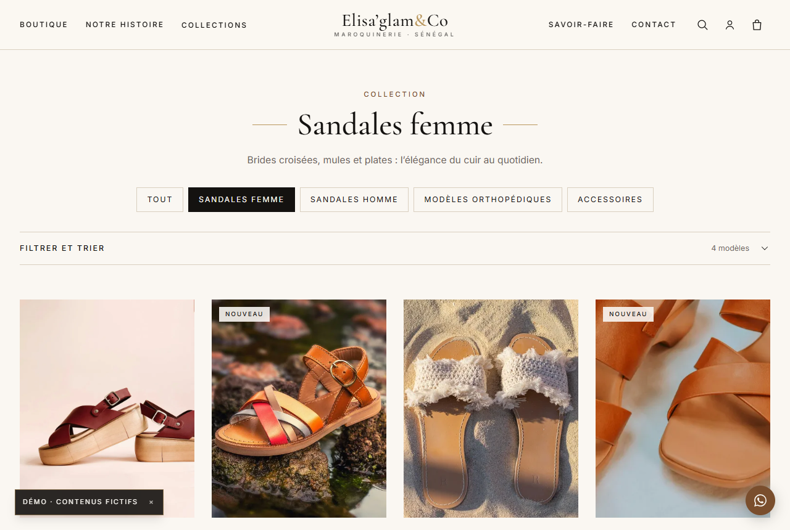
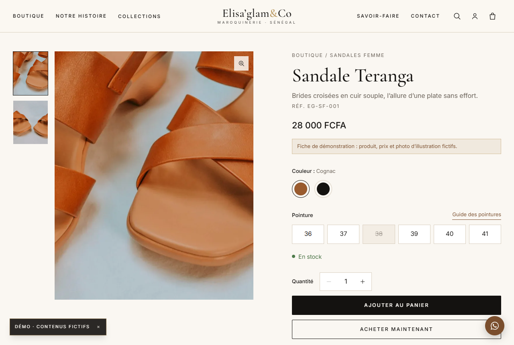
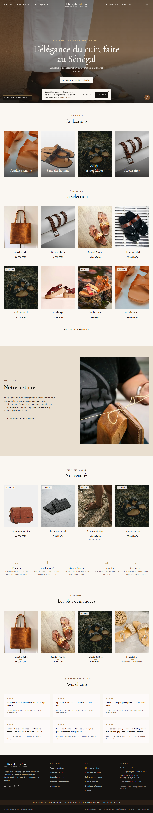

# Elisa'glam&Co — site e-commerce

Boutique en ligne de maroquinerie artisanale premium sénégalaise. Mobile first, administrable en français.

**Stack :** Next.js (App Router) + TypeScript · Tailwind CSS · Payload CMS (admin en français) · PostgreSQL (SQLite en local) · PayDunya (Wave, Orange Money) derrière une couche `PaymentProvider`.

> **Site de démonstration** : produits, prix, textes, avis et coordonnées sont fictifs ; les photos viennent d'Unsplash (licence libre). Voir `CONTENUS_A_FOURNIR.md` et `docs/RECETTE.md`.

## Aperçu

| Accueil — mobile | Collection — ordinateur |
|:---:|:---:|
|  |  |



<details>
<summary>Voir toute la page d'accueil (capture complète)</summary>



</details>

Captures régénérables avec : `node scripts/site-shot.mjs docs/screenshots` (serveur lancé).

## Démarrage rapide

```bash
npm install --legacy-peer-deps
cp .env.example .env
npm run seed          # données de démonstration (SEED_RESET=1 pour tout recréer)
npm run dev           # http://localhost:3010  (admin : /admin)
# compte de démonstration local : admin@elisaglam.test (mot de passe fixé par SEED_ADMIN_PASSWORD au seed)
# code promo de démonstration : BIENVENUE10 (-10 %)
npm run test:e2e      # tests Playwright du tunnel d'achat
```

## Documentation

| Fichier | Contenu |
|---|---|
| `SPEC.md`, `DESIGN.md` | Spécifications, direction artistique |
| `CONTENUS_A_FOURNIR.md` | Tout ce que la propriétaire doit fournir |
| `docs/GUIDE_ADMIN.md` | Utiliser l'administration |
| `docs/MAINTENANCE.md` | Déploiement, paiement, sécurité, dépannage, accès |
| `docs/SAUVEGARDE.md` | Sauvegarde et restauration |
| `docs/RECETTE.md` | Critères de recette : ce qui est vérifié et ce qui reste à faire |
| `docs/CAHIER_DES_CHARGES.pdf` | Cahier des charges d'origine |

## Structure

```
src/app/(frontend)   pages du site          src/app/(payload)  administration
src/collections      modèle de données       src/globals        réglages et contenus
src/lib/payments     abstraction paiement    src/components     composants
scripts              seed, sauvegarde, captures   tests   tests Playwright
```

## Licence

Sous licence [MIT](./LICENSE) — tu peux consulter, réutiliser et adapter le code en conservant la mention de copyright.
