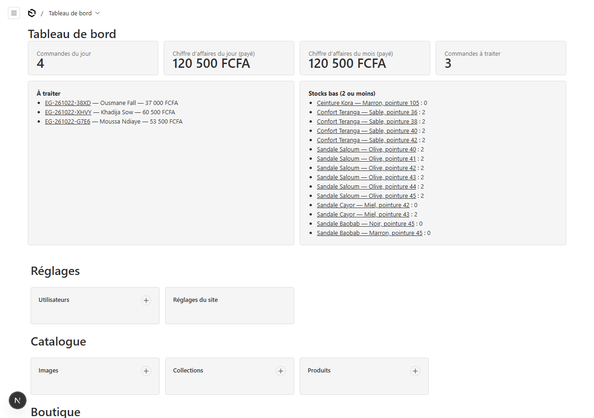
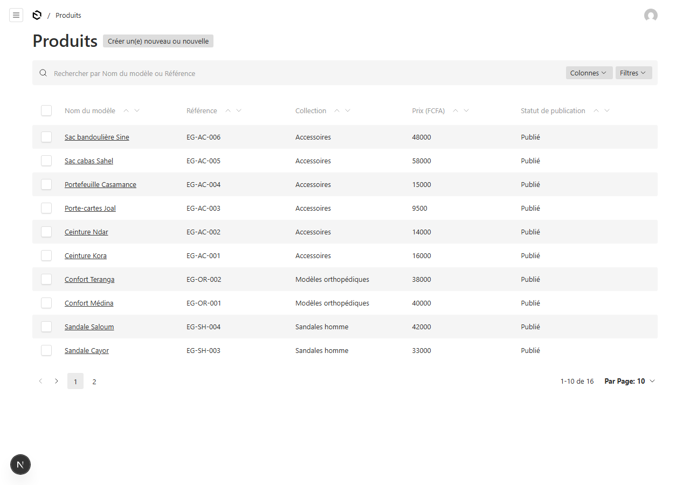
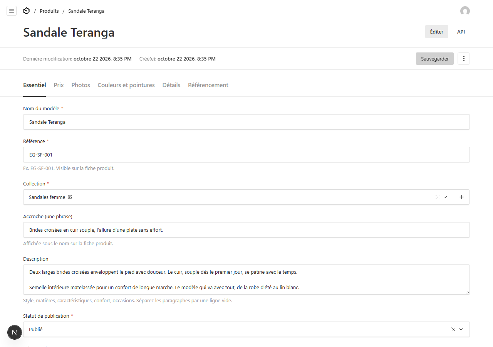
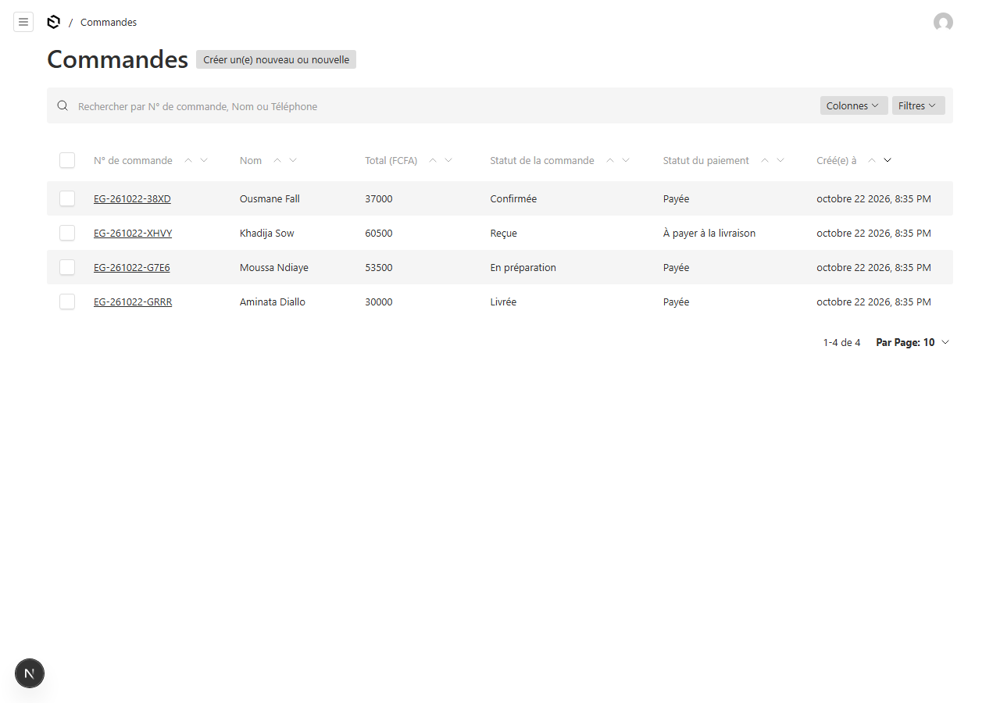

# Guide d'administration — Elisa'glam&Co

Ce guide explique, en français simple, comment gérer la boutique sans l'aide d'un développeur.
L'administration fonctionne aussi sur téléphone.

> Les captures ci-dessous montrent les données de démonstration.

## 1. Se connecter

1. Ouvrez `https://votre-domaine/admin`.
2. Saisissez votre email et votre mot de passe.
3. Après 5 mots de passe erronés, le compte est bloqué 10 minutes (protection contre le piratage).

**Premier lancement :** si aucun compte n'existe, l'écran « Créer le premier utilisateur » s'affiche. Ce premier compte est automatiquement **administratrice**.

Deux rôles :
- **Administratrice** : accès à tout (commandes, réglages, codes promo, utilisateurs).
- **Éditeur** : catalogue et contenus uniquement, sans accès aux commandes ni aux réglages.

Créez un mot de passe fort (12 caractères minimum, avec chiffres et symboles) et ne le partagez pas.

## 2. Le tableau de bord

À l'ouverture de l'administration, vous voyez :
- les **commandes du jour** et le **chiffre d'affaires** (jour et mois, paiements confirmés uniquement) ;
- les **commandes à traiter** (cliquez sur le numéro pour l'ouvrir) ;
- les **stocks bas** (2 exemplaires ou moins).

## 3. Ajouter un produit

1. Menu **Catalogue → Produits → Créer**.
2. Onglet **Essentiel** : nom du modèle, référence (ex. `EG-SF-014`), collection, accroche, description. L'adresse web se crée toute seule.
3. Onglet **Prix** : prix en FCFA. Pour une promotion, saisissez le prix promotionnel et les dates de début et de fin.
4. Onglet **Photos** : cliquez sur « Ajouter » pour chaque photo. **Glissez-déposez pour réordonner.** La 1re photo est l'image principale, la 2e s'affiche au survol. Ajoutez un texte alternatif (description courte de la photo).
5. Onglet **Couleurs et pointures** : ajoutez uniquement les couleurs réellement disponibles. Pour chaque couleur, ajoutez les pointures avec leur **stock**. Une pointure à 0 s'affiche barrée et grisée.
   - Fabrication à la demande : choisissez « Sur commande » et indiquez le délai.
6. Onglet **Détails** : matières, entretien, conseil de pointure (informations vérifiées uniquement).
7. Statut **Publié** (colonne de droite) pour afficher le produit, **Brouillon** pour le cacher.
8. Cliquez sur **Sauvegarder**.

Pour **dupliquer** un produit : ouvrez-le, menu « ⋮ » → Dupliquer.
Pour **retirer** un produit sans le supprimer : passez-le en **Brouillon**.

## 4. Modifier un prix ou un stock

1. **Produits** → ouvrez le produit.
2. Onglet **Prix** pour le prix ou la promotion ; onglet **Couleurs et pointures** pour le stock.
3. **Sauvegarder** : le site est mis à jour immédiatement.

## 5. Consulter et traiter une commande

1. Menu **Boutique → Commandes**. Cliquez sur une commande.
2. Vous voyez : client, téléphone, adresse, articles, montants, mode et statut de paiement.
3. Le lien **WhatsApp** (onglet « Client et livraison ») ouvre une conversation avec le client.
4. Changez le **statut** : *Reçue → Confirmée → En préparation → Expédiée → Livrée* (ou *Annulée*). Un email est envoyé au client si son adresse est renseignée.

**Paiement en ligne (Wave, Orange Money)** : la commande passe automatiquement à « Payée » et « Confirmée » dès que le paiement est reçu. Le stock est alors décompté.

**Paiement à la livraison** : contactez le client par WhatsApp ou par appel, cochez **« Confirmée avec le client »** (onglet Suivi interne), puis passez la commande à « Confirmée ». Le stock est décompté à ce moment. Après livraison et encaissement, passez le statut du paiement à « Payée ».

**Annulation** : en passant la commande à « Annulée », le stock décompté est automatiquement remis.

## 6. Modifier les textes, la page d'accueil, les contacts

- **Page d'accueil** (menu Contenus) : photo et texte de la bannière, produits mis en avant, histoire, engagements, ordre des sections.
- **Réglages du site** : numéro WhatsApp, téléphone, email, adresse, réseaux sociaux, modes de paiement activés, email de notification, identifiants Google Analytics / Meta Pixel.
- **Pages de contenu** : histoire, savoir-faire, livraison et retours, mentions légales, CGV, etc.
- **FAQ** et **Guide des pointures** : ajoutez, modifiez ou supprimez des lignes.

## 7. Livraison et codes promo

- **Zones de livraison** : nom, frais, délai, paiement à la livraison autorisé ou non, active ou non.
- **Codes promo** : code, type (pourcentage ou montant), valeur, date limite, nombre maximum d'utilisations, montant minimum.

## 8. Avis clients

Menu **Boutique → Avis clients** : saisissez un avis réel reçu d'un client (prénom, produit, note, texte) puis passez-le à **Publié**. Seuls les avis publiés sont affichés. **Ne publiez jamais d'avis fictifs.**

## 9. Messages du formulaire de contact

Menu **Boutique → Messages de contact**. Cochez « Traité » une fois la réponse envoyée.

## 10. En cas de problème

Voir `docs/MAINTENANCE.md`. Pour une urgence (site inaccessible, paiement bloqué), contactez la personne chargée de la maintenance.
